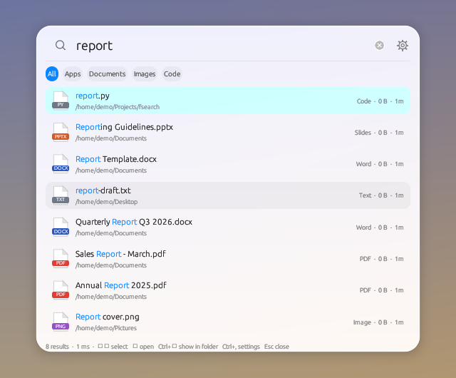
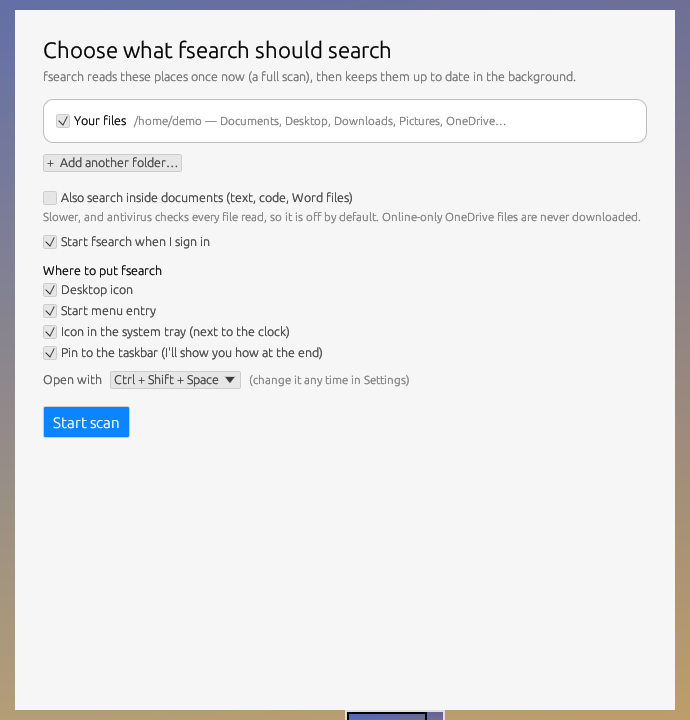
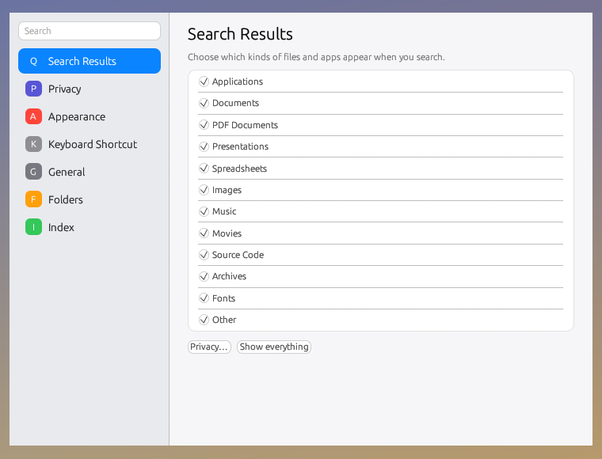
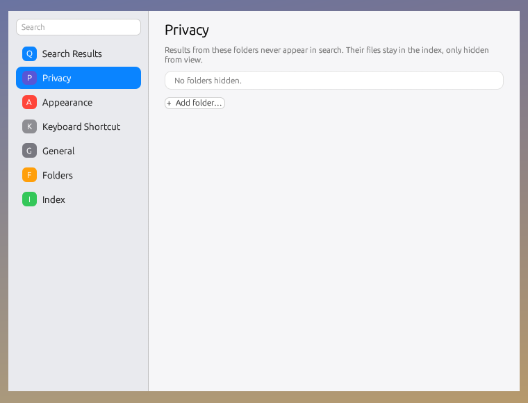
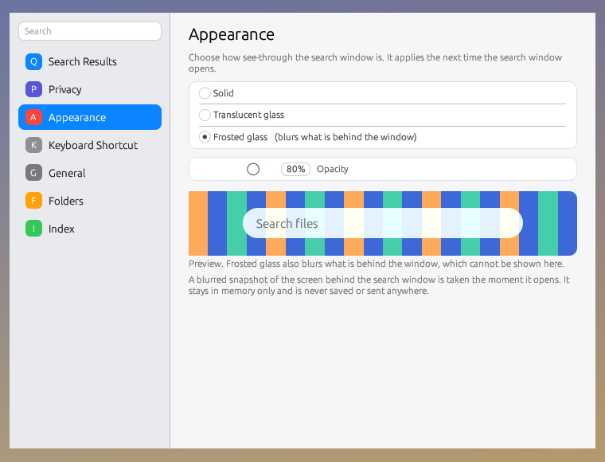
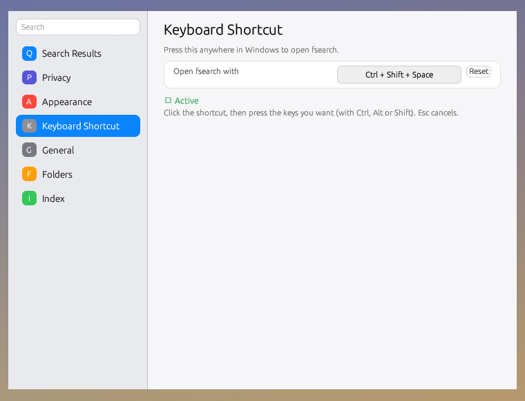
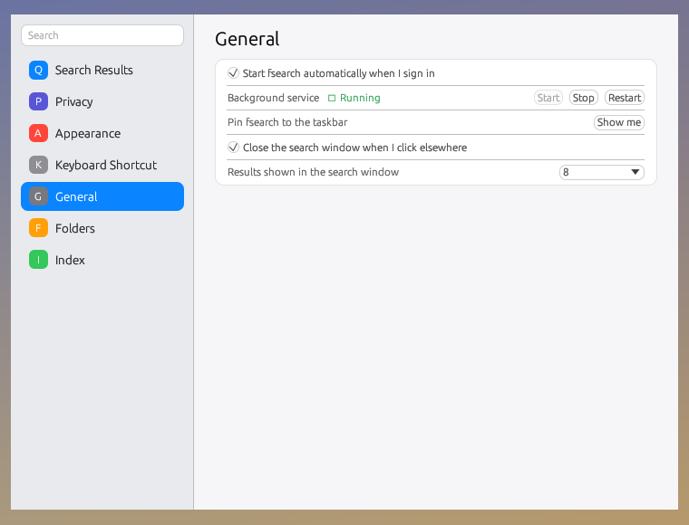
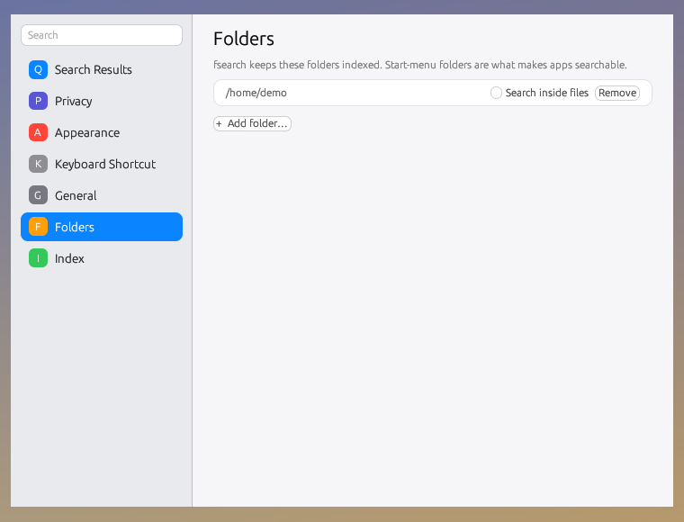
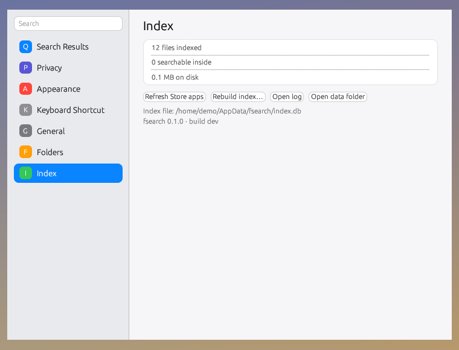

# fsearch

Fast, Spotlight-style file search for Windows: press a shortcut, type, open. fsearch keeps a local index of your files
(names and, optionally, the text inside documents), updates it live in the background, and shows results as you type.

<p align="center"></p>

> The screenshots in this README are taken from the program itself with sample files. Fonts and the frosted-glass
> blur look a little different on a real Windows PC.

## Contents
[Install](#install) · [First run](#first-run) · [Using it](#using-it) · [Settings](#settings) · [How it works](#how-it-works) ·
[Command line](#command-line) · [Build from source](#build-from-source) · [Limits](#limits) · [License](#license)

## Install

1. Download **`fsearch-setup.exe`** from the [latest release](../../releases/latest).
2. Run it. Windows may show *"Windows protected your PC"* because the file is not code-signed with a purchased
   certificate: choose **More info → Run anyway**. (You can compare the file with `fsearch-setup.exe.sha256` using `Get-FileHash`.)
3. The setup window opens (see below).

No administrator rights are needed. Everything is installed under `%LOCALAPPDATA%\fsearch`.
To remove it: **Settings → Apps → fsearch → Uninstall** (this deletes the programs and the index).

## First run

<p align="center"></p>

The first time, a short setup asks what to search and then does a **full scan** (like Spotlight's first indexing):

- **Where to search:** your user folder (default), any whole drive, or folders you add.
- **Search inside documents:** also read text, code and Word files (slower, off by default).
- **Start at sign-in**, the **open shortcut**, and **where to put fsearch**: desktop icon, Start-menu entry,
  system-tray icon, and a how-to for pinning it to the taskbar (Windows does not let programs pin themselves).

During the scan you see a progress bar with a percentage, files per second and the time left. You can keep using the PC;
search works as soon as the scan is done, and apps are indexed first so they are findable within seconds.

## Using it

<p align="center"></p>

Press **Ctrl + Shift + Space** anywhere (changeable in Settings). The bar opens in the middle of the screen you are on.
Type to search; the window expands to show results, best match first, then grouped by kind (apps, documents, images, media, other, code).

| | |
|---|---|
| ↑ ↓ | select |
| Enter | open |
| Ctrl + Enter | show in folder |
| Ctrl + 1 … 5 | All / Apps / Documents / Images / Code |
| right-click a result | open, run as administrator, show in folder, open with…, copy file / path / name, open folder in Terminal |
| ✕ in the search box | clear what you typed |
| Esc, click elsewhere, or the shortcut again | close |

Files are found by name; with *Search inside documents* on, also by their text. Arabic and other right-to-left text
displays correctly. Query words you can type:

    invoice                           name or content contains "invoice"
    name:budget ext:xlsx              name contains budget, extension xlsx
    kind:image modified:>2026-01-01   images changed after that date
    size:>5mb  path:projects          bigger than 5 MB, under a path containing "projects"
    content:"fast search"  -ext:tmp   text inside files; exclude an extension

## Settings

Open **fsearch Settings** from the Start menu, the tray icon, or the gear in the search bar (Ctrl + ,).
It is laid out like macOS *System Settings → Siri & Spotlight*.

<table>
<tr>
<td width="50%"><br><b>Search Results</b> — choose which kinds of files appear (applications, documents, PDFs, spreadsheets, images, music, movies, source code, archives, fonts, other).</td>
<td width="50%"><br><b>Privacy</b> — folders whose files never show up in search. They stay in the index but are hidden from results.</td>
</tr>
<tr>
<td><br><b>Appearance</b> — solid, translucent glass, or frosted glass (blurs what is behind the window), with an opacity slider and a live preview.</td>
<td><br><b>Keyboard Shortcut</b> — click the shortcut and press the keys you want. It tells you if another program already uses it.</td>
</tr>
<tr>
<td><br><b>General</b> — start at sign-in, start / stop / restart the background service, pin to the taskbar, close the window when you click elsewhere, and how many results to show.</td>
<td><br><b>Folders</b> — the folders fsearch keeps indexed. Per folder you can turn <i>Search inside files</i> on or off; add or remove folders.</td>
</tr>
<tr>
<td colspan="2"><br><b>Index</b> — how many files are indexed, refresh Microsoft Store apps, rebuild the index, open the log or the data folder.</td>
</tr>
</table>

## How it works

```
 sign-in ──► background service (fsearch.exe)
              ├─ tray icon + global hotkey
              ├─ first scan / re-check of your folders   (apps first, runs at low priority)
              ├─ live watcher: file added / changed / deleted → index updated
              └─ keeps the search window ready (hidden)
                         │  hotkey → signal
                         ▼
 search window (fsearch-gui.exe, stays running, hidden)
   shows instantly ──► you type ──► query ──► SQLite index ──► ranking ──► results
```

- **Index.** One SQLite database (`index.db`) with FTS5: a trigram index for file names (so any part of a name matches
  instantly) and an optional full-text index for file contents. Online-only OneDrive files are indexed by name only and
  never downloaded.
- **Service.** `fsearch.exe` runs per user (started from the registry *Run* key, no admin needed). It waits a minute after
  sign-in before heavy work, runs at background priority, and skips noisy folders such as `AppData` and `node_modules`.
- **Search window.** `fsearch-gui.exe` stays running, parked off-screen, so the shortcut only sends a signal and the window
  appears at once; closing it just hides it again. Frosted glass photographs the screen right before it appears.
- **Ranking.** Exact name > starts with > word start > inside the name. Start-menu apps get a bonus; your Desktop, Documents,
  Downloads and Pictures beat tool folders; recent and often-opened files rise. The best match stays first and the rest are
  grouped by kind.
- **Same model as Spotlight.**

| Spotlight | fsearch |
|---|---|
| `mds_stores` index | `store.rs` — SQLite with FTS5 (trigram names + content) |
| `mdworker` importers | `importer.rs` — text, code, Word extractors |
| `mds` initial crawl | `indexer.rs`, `setup_ui.rs` (first-run scan) |
| FSEvents | `watcher.rs` — live updates |
| `mdfind` | `query.rs`, `rank.rs` — query language and ranking |
| Spotlight window | `src/bin/fsearch-gui.rs` (egui) |

Written from public documentation and observed behaviour; contains no Apple code.

## Command line

`fsearch.exe` (in `%LOCALAPPDATA%\fsearch`) is also a CLI: `find`, `index`, `add`, `remove`, `roots`, `status`, `hotkey`,
`install`, `uninstall [--purge]`. Run `fsearch --help`.

## Build from source

Windows (MSVC): install [Rust](https://rustup.rs) and the *Desktop development with C++* tools, then

    cargo build --release --features gui
    # installer: copy the two exes into payload\ first
    cargo build --release --features bundle --bin fsearch-setup

From Linux, `./build-installer.sh` cross-compiles for `x86_64-pc-windows-gnu` (set `ZIG_WRAP` to a folder with
`zcc`/`zlink`/`zar` wrappers around `zig cc`, or install mingw-w64). `SIGN_KEY` and `SIGN_CERT` optionally sign the files
(needs `osslsigncode`).

`cargo test` runs the engine tests. Pushing a tag like `v0.1.0` makes GitHub Actions build and publish `fsearch-setup.exe`.

## Limits

- Not signed with a purchased code-signing certificate, so SmartScreen warns on first run.
- Names are indexed by scanning; there is no NTFS MFT/USN fast path yet.
- Content extraction covers plain text, code and `.docx`; PDF/xlsx/pptx text is not indexed yet.
- Developed and verified on one Windows 11 PC; other setups may reveal issues — please open an issue.

## License

MIT — see [LICENSE](LICENSE).
